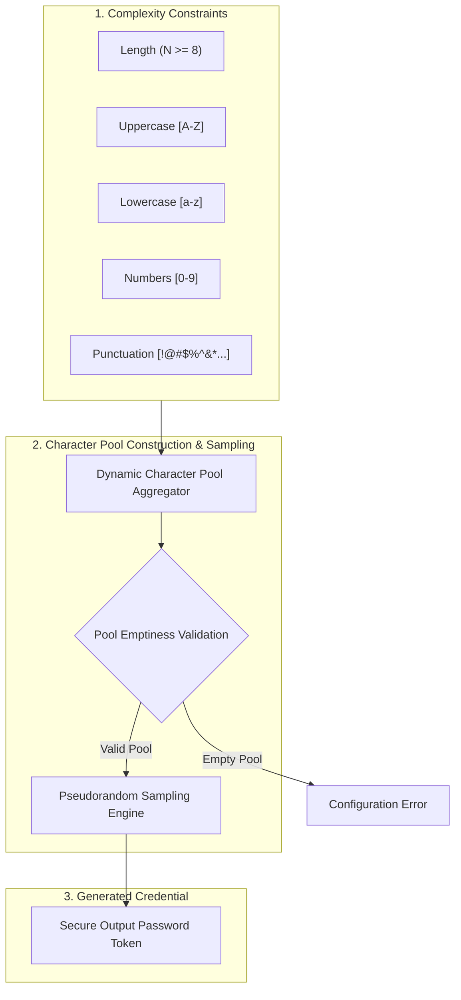

# Configurable Cryptographic Password Generator

[](https://www.python.org/)
[](https://en.wikipedia.org/wiki/Password_strength)
[](https://en.wikipedia.org/wiki/Command-line_interface)
[](https://opensource.org/licenses/MIT)

A robust, configurable password generation utility developed in Python. Designed to construct cryptographically unpredictable credentials adhering to customizable complexity requirements across enterprise character classes (uppercase, lowercase, numeric digits, and punctuation symbols).

---

## 🏛️ Entropy & Complexity Engine



---

## ⚡ Mathematical Entropy Estimation

For a generated password of length $L$ drawn from an alphabet of size $N$, total information entropy in bits is calculated as:
$$H = L \cdot \log_2(N)$$

| Character Set Selection | Alphabet Size ($N$) | Entropy for $L=16$ | NIST Strength Category |
| :--- | :--- | :--- | :--- |
| Digits Only | 10 | $\approx 53.15 \text{ bits}$ | Weak |
| Lowercase + Digits | 36 | $\approx 82.72 \text{ bits}$ | Reasonable |
| Lowercase + Uppercase + Digits | 62 | $\approx 95.27 \text{ bits}$ | Strong |
| **All Sets (Alphanumeric + Symbols)** | **94** | **$\approx 104.87 \text{ bits}$** | **Enterprise Hardened** |

---

## 📂 Repository Structure

```text
Password-generator-microIt-project-/
├── password.py                 # Core password generator function & interactive CLI
└── README.md
```

---

## 🚀 Execution & Usage

### 1. Clone the Repository
```bash
git clone https://github.com/ak-bharadwaj/Password-generator-microIt-project-.git
cd Password-generator-microIt-project-
```

### 2. Run Interactively
```bash
python password.py
```

### 3. Example Execution Session
```text
Password Generator
Enter password length: 16
Include uppercase letters? (y/n): y
Include lowercase letters? (y/n): y
Include numbers? (y/n): y
Include special characters? (y/n): y
Generated Password: jK8#v9!Lp$2@mXqZ
```
